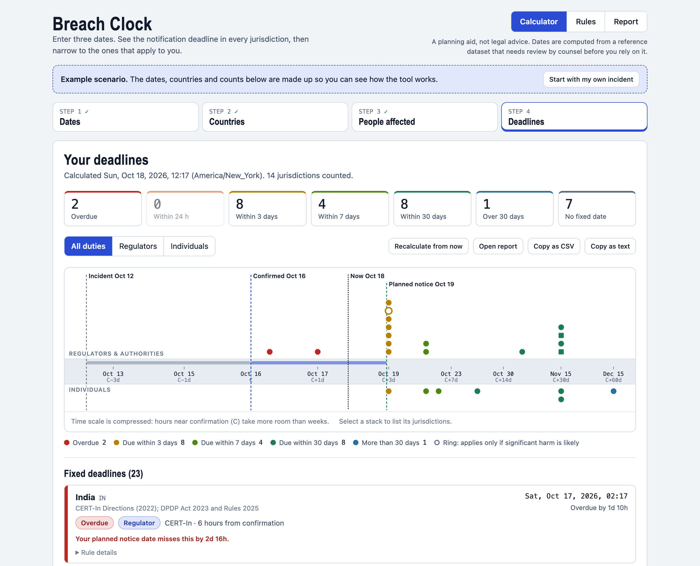

# Breach Clock

A single-page tool that works out when a personal-data breach must be notified, jurisdiction by jurisdiction.

Enter three dates (when the incident happened, when you confirmed it, and when you notified or plan to). Breach Clock computes the notification deadline for 208 jurisdictions, lets you pick the ones that apply, asks how many people are affected in each, and then shows the deadlines as a color-coded list and a timeline. A second view lists every rule behind those dates and lets you edit them, with a full history of every change and a review workflow for changes from several people. A third produces a printable report.

> **Not legal advice.** Breach Clock is a planning aid. The rule set is a reference dataset (snapshot: October 2026) that needs review by counsel before anyone relies on it. See [Accuracy and limits](#accuracy-and-limits).



*The Deadlines step, using the built-in example scenario. Regulator deadlines sit above the timeline axis and individual deadlines below it, colored by how close they are. The dashed lines mark the incident, confirmation, the current time and the planned notice.*

## Run it

The app is one file (`index.html`) with no dependencies, no build step and no network requests. The screenshot above is only used by this README.

- **Locally:** open `index.html` in any modern browser.
- **On GitHub Pages:** see [Host it on GitHub Pages](#host-it-on-github-pages).

## Features

### Calculator

1. **Dates.** Enter the incident, confirmation and (optionally) notification date and time. A timeline of every jurisdiction's deadline appears immediately, along with the shortest clocks in the dataset.
2. **Countries.** Search or browse by region and tick the jurisdictions that apply. Quick buttons add whole groups (EU/EEA and UK, Asia and Oceania, and so on). United States rules are listed per state because they differ.
3. **People affected.** Enter how many people are affected in each jurisdiction. Counts decide which regulator duties apply: for example, South Korea requires a regulator report from 1,000 people, and Texas requires an Attorney General notice from 250. Leave a count blank if unknown (it is treated as meeting every threshold). Enter 0 to leave a jurisdiction out.
4. **Deadlines.** A summary strip, a timeline and a list sorted by urgency.

What the results show:

- **Color-coded urgency.** Overdue, due within 24 hours, within 3 days, within 7 days, within 30 days, and later. Every status also has a text label, so color is never the only signal.
- **Your planned notice date, tested against every deadline.** Each row says whether the date you plan to notify on meets the deadline and by how much, or misses it and by how much. If you already notified, rows show "Notified in time" or "Notified late".
- **Follow-on clocks.** Some duties start after you notify (for example, California's 15 days to inform the Attorney General, or Malaysia's 7 days to inform individuals). They start from your notification date.
- **Duties with no fixed date.** Laws that say "without undue delay" are listed separately, with how long the clock has been running.
- **Volume thresholds.** Duties that don't apply at your count are tucked into a "Not triggered at this volume" section. Duties that apply below a threshold only if significant harm is likely are drawn as rings on the timeline.
- **Not yet in force.** Rules with a future effective date (for example India's DPDP breach provisions, or Chile's new law) are held back and labeled.
- **Timeline.** Time is on a compressed scale so hours near confirmation and weeks later are both readable. Regulators sit above the axis, individuals below. Select a stack of dots to see which jurisdictions share a deadline.
- **Rule details on every row.** Legal basis, rule, start point, conditions, volume threshold, source check, and last-reviewed date and source if recorded.
- **Copy out.** "Copy as CSV" and "Copy as text" put the results on your clipboard.

Options on the Dates step:

- **Start the clock at:** confirmation (how most laws work) or the incident date (a conservative view).
- **Evaluate as of:** right now, or a specific time. Use it to ask "where will we stand on Friday?"

### Rules

Switch to **Rules** at the top of the page to see every rule the calculator uses.

- **Browse.** Search by name, code, law, authority or condition. Filter by region, duty type (fixed deadline, without undue delay, voluntary, none identified), source check, or edited only. Sort by name, region, fastest deadline or recently edited. "Show full rule text" expands each row.
- **Edit.** Open any jurisdiction to change its name, region, law, source check, review date, source and notes. Each jurisdiction has a list of **duties** (one notice each). For every duty you set who is told, the authority, the legal basis, the deadline (as soon as possible, hours, calendar days or business days), what the clock starts from (confirmation, incident or notification), a volume threshold with an optional "still applies if significant harm is likely", an effective date, a voluntary flag, a per-duty source check, and conditions and notes.
- **Live preview.** Under each duty, the date it would produce using the dates from step 1.
- **Validation.** Problems are marked in the field and Save stays disabled until they are fixed.
- **Add and remove.** Add or delete duties, duplicate them, and reorder them. Add your own jurisdictions (for example a state or sector rule).
- **Reset.** "Reset to built-in" returns one rule to its original. "Reset all edits" returns everything.
- **Edits apply immediately** to the calculator, and edited rules carry an "Edited rule" marker in the results.

### Report

Switch to **Report** (or click **Open report** on the Deadlines step) for a one-document summary you can keep or hand to counsel. It covers:

- the incident timeline (incident, confirmation, notification, the time it was evaluated, and which date clocks start from)
- a summary with the number of deadlines in each urgency band and how many the planned notice date misses
- the timeline graphic
- every fixed deadline in a table: due date, jurisdiction, who is told, rule and legal basis, status, and whether the planned notice date meets it
- duties with no fixed date, and clocks that start when you notify
- affected people by jurisdiction, including which duties fall below a threshold
- what is not in the list (not triggered, not yet in force, no deadline identified)
- the rule set in use: the built-in snapshot, plus any rules edited or added in this copy of the tool with their change and review dates and sources
- the assumptions behind the numbers

Ways to get it out:

- **Print or save as PDF** uses your browser's print dialog. The page switches to a clean black-on-white layout with only the report on it.
- **Save as HTML file** downloads a single self-contained file you can archive, email or print later.
- **Copy as text** puts a plain-text version on your clipboard.

Printing is blocked inside Claude artifact viewers, so there the Print button is replaced by a note and the Save as HTML file option.

### Rule history

In the Rules view, switch from **Rules** to **History**. Every edit, new jurisdiction, deletion, reset, import and restore is logged with the time and a plain-language list of what changed (for example "Duty 1 (Regulator) deadline: 72 hours → 48 hours"). In the shared artifact each entry also shows who made it.

- **Restore.** Put a rule back to the version it had before a given change. If the rule has changed since, you are warned that later changes will be replaced. Restoring is itself logged, so nothing is ever lost.
- **Filter.** Search by jurisdiction or change text, or filter by type of change. **History** in a rule's editor jumps straight to that rule's log.
- **Export.** Export the whole log as CSV for audit.
- **Clear.** Deletes the log (rules are not changed). Only offered to people who can edit.

History is kept in the same place as the rules: in this browser's local storage in the standalone app (up to 1,000 entries), or shared with everyone in the Claude artifact.

### Proposals and review

When several people revise the rules, changes can go through review instead of being saved straight away. In the Rules view, switch to **Proposals**.

- **Propose.** Editing a rule, adding a jurisdiction, or importing a rules file creates a **proposal**: a named set of changes with an author and an optional reason. Nothing changes in the live rules.
- **See it before it happens.** A proposal shows exactly what would change, rule by rule, as a before and after table, plus a preview of what publishing would change in the live rule.
- **Review one rule at a time.** Open a proposal and step through its rules. For each one, **Approve** or **Reject**, with an optional reviewer note. Approving takes the whole rule at once. Reviewers can approve their own proposals.
- **Three-way view for conflicts.** If a rule changed after the proposal was drafted, the review shows three versions side by side: **Base** (the rule when the proposer started), **Proposed**, and **Current** (the live rule now). Changes that do not overlap are merged automatically. Where both sides changed the same thing, you pick **Use proposed** or **Keep current** for that row, and the approval is blocked until every conflict is resolved. The same applies to duties that were added, removed or edited on either side.
- **Publish is a separate step.** Approved rules wait until an editor clicks **Publish**. Publishing lists what will change, applies only the approved rules, and records each one in the history with the proposal's title.
- **Stale approvals are caught.** If the live rule changes after a rule was approved, the approval no longer applies and the rule goes back to "Needs re-review". Editing a proposal after review also clears earlier decisions.
- **Require review.** The checkbox at the top of the Proposals view controls whether editors can save changes directly or must also go through proposals. In the shared Claude artifact it is on by default. In the standalone app it is off by default, and you can still propose and review.

In the shared Claude artifact, anyone who can contribute can propose, only editors can approve, reject and publish, and each proposal, decision and publish shows who did it. In the standalone app there is no server, so proposals move between people as files:

1. The proposer clicks **Export file** on a proposal and sends the JSON file.
2. The reviewer opens **Back up, share or restore rules**, imports the file, and clicks **Stage as proposal**.
3. The reviewer reviews and publishes it in their own copy. Because the file carries the proposer's base version, the three-way view still works if the reviewer's rules have changed since.

History restore is a direct action available to editors, so it is not routed through review.

## How to use it

### First run

The page opens with a made-up example scenario so you can see how it works. Click **Start with my own incident** to clear it.

### A typical session

1. On **Dates**, enter the confirmation date. Add the incident date, and the notification date if you have one.
2. Click **Choose countries** and tick the jurisdictions where affected people live or where you operate.
3. Click **Enter affected counts** and fill in a number for each.
4. Click **Show deadlines**. Work down the list from the top: overdue and imminent deadlines come first.
5. Use "Recalculate from now" to refresh the relative times (for example "in 4h 20m") after some time has passed.

Dates and times are interpreted in your browser's time zone, which is shown on the Dates step.

### Editing a rule

1. Switch to **Rules**, find the jurisdiction, and click **Edit**.
2. Change what you need. The preview under each duty updates as you type.
3. Click **Save**, or **Propose change** if review is required. Click **Cancel** or press Esc to abandon changes (you will be asked to confirm if there are unsaved edits).
4. Record where the change came from in **Last reviewed** and **Source link or citation**, so the next person can see why it differs from the built-in rule.

### Backing up and moving your rules

Open **Back up, share or restore rules** at the bottom of the Rules view.

- **Export edited rules** downloads only the rules you changed or added, as JSON.
- **Export all rules** downloads the full rule set.
- **Import rules** takes a JSON file (a rules export or a proposal file) or pasted JSON, and shows what would change in each rule. You then **Stage as proposal**, or apply directly if review is not required.
- **Reset all edits** removes every edit and custom jurisdiction. Each reset is recorded in the history.

To share your edits with a colleague, export them and send the file; they import it in their own browser. To move to a new browser or machine, do the same.

## Host it on GitHub Pages

1. Create a repository and add `index.html` and `README.md` at the top level.
2. In the repository, go to **Settings > Pages**.
3. Under **Build and deployment**, choose **Deploy from a branch**, pick your main branch and the `/ (root)` folder, and save.
4. After a minute or so the site is live at `https://<your-username>.github.io/<repository-name>/`.

If you keep the app in a subfolder instead, point Pages at that folder or use a `/docs` folder. No other configuration is needed, since the app is a single static file.

The same file works on any static host (Netlify, S3, an internal web server) or from a USB stick.

## Data and privacy

- **Incident dates, selections and counts are never stored or sent.** They exist only in the open page. Reloading clears them.
- **Rule edits, their history and proposals are stored in your browser's local storage**, under the keys `breach-clock:rules:v1`, `breach-clock:history:v1` and `breach-clock:proposals:v1`, on the site's origin. They stay on your device. Clearing site data for the page removes them, so export a copy if they matter. The history log is not part of the rules export; use **Export history (CSV)** to keep it.
- **Local storage is shared by every page on the same origin.** On GitHub Pages, `https://<your-username>.github.io` is one origin for all of your project sites. The key is namespaced, but if you want strict separation, host the app on its own custom domain.
- **No network requests.** There are no fonts, scripts, analytics or images loaded from elsewhere. The page uses your system fonts, so the look varies slightly by device.
- **If the browser blocks local storage** (some private windows, strict settings), edits still work but last only until you reload. A warning appears on the Rules view. Export to keep them.

## Accuracy and limits

- **Reference data, not legal advice.** The rule set was compiled and partly cross-checked in October 2026. Laws change, and every jurisdiction has exceptions, thresholds and sector rules that a table cannot capture.
- **Source check tags.** Each rule is tagged:
  - **Checked:** cross-checked against current published sources when the dataset was built.
  - **Established:** settled law, from general knowledge, not re-checked.
  - **Verify:** recent, ambiguous or thinly sourced. Confirm before relying on it.
- **"No deadline identified" is not "no obligation".** About half the jurisdictions in the dataset have no fixed deadline recorded. Many have laws the dataset does not cover well.
- **Not modelled:** sector regimes such as NIS2, DORA, GLBA and bank or telecom regulator rules, contractual deadlines, and law-enforcement delay exceptions.
- **Business days** skip Saturdays and Sundays only. Local public holidays are not applied. Day counts keep the same clock time as their starting point.
- **One notification date.** The calculator treats your notification date as the day both regulators and individuals are told. If you notify them on different days, check each duty on its own.
- **Counts are your input.** The tool applies thresholds to the numbers you enter. It does not decide whether a breach is reportable (harm, risk, or materiality tests are listed as conditions for you to judge).

## Rule format

Exports and imports use this JSON shape. You can edit it by hand.

```json
{
  "format": "breach-clock-rules",
  "version": 1,
  "rules": {
    "DE": {
      "id": "DE",
      "name": "Germany",
      "region": "eu",
      "law": "GDPR + BDSG",
      "conf": "known",
      "note": "",
      "reviewedOn": "2026-10-05",
      "source": "https://example.org/citation",
      "obl": [
        {
          "aud": "reg",
          "auth": "Competent state DPA",
          "basis": "GDPR Art. 33",
          "timing": "72h",
          "cond": "Unless the breach is unlikely to result in a risk to individuals."
        }
      ]
    }
  }
}
```

| Field | Values |
| --- | --- |
| `region` | `eu`, `eo`, `na`, `la`, `as`, `oc`, `me`, `af` |
| `conf` (jurisdiction or duty) | `checked`, `known`, `verify` |
| `obl[].aud` | `reg` regulator, `sub` individuals, `oth` other party, `asm` internal assessment |
| `obl[].timing` | `asap`, or a number followed by `h` (hours), `d` (calendar days) or `bd` (business days), such as `72h`, `30d`, `3bd` |
| `obl[].from` | Omit for confirmation. `i` for incident, `n` for notification |
| `obl[].min` | Whole number. The duty applies from this many affected people |
| `obl[].harm` | `true` to still apply below `min` if significant harm is likely |
| `obl[].eff` | `YYYY-MM-DD`. The duty is held back until this date |
| `obl[].vol` | `true` for voluntary or guidance-only duties |
| `obl[].cond` | Free-text conditions and notes |

Region codes: `eu` EU/EEA and UK, `eo` Europe (other), `na` North America, `la` Latin America and Caribbean, `as` Asia, `oc` Oceania, `me` Middle East, `af` Africa. An import ignores unknown fields and skips any rule that does not validate.

The built-in rules live in the `BASE_JURISDICTIONS` array near the top of the script in `index.html`, in the same shape (with short helper functions). Edits made in the app are layered on top of it and never change the file.

## Proposal file format

A proposal file is JSON, and an import also accepts a plain rules file (it uses the current rule as the base).

```json
{
  "format": "breach-clock-proposal",
  "version": 1,
  "title": "Update Germany",
  "description": "Why this change is proposed",
  "author": "Alice",
  "createdAt": "2026-10-18T12:00:00.000Z",
  "items": [
    {
      "rid": "DE",
      "name": "Germany",
      "base": { "id": "DE", "name": "Germany", "region": "eu", "obl": [] },
      "proposed": { "id": "DE", "name": "Germany", "region": "eu", "obl": [] }
    }
  ]
}
```

Each item is one rule, in the same shape as in [Rule format](#rule-format). `base` is the rule as the proposer saw it (`null` for a new jurisdiction) and `proposed` is the new version (`null` to delete a custom jurisdiction). The base is what makes the three-way view possible.

## Browser support

Any current version of Chrome, Edge, Firefox or Safari. The page uses CSS `color-mix()`, `Intl.DateTimeFormat` and `<details>` elements, and follows your system light or dark setting.
